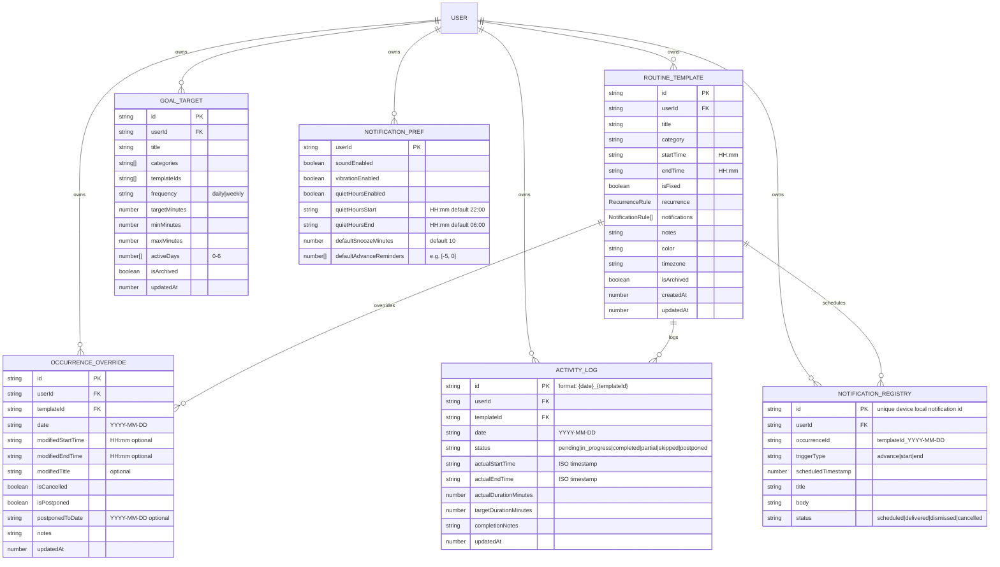
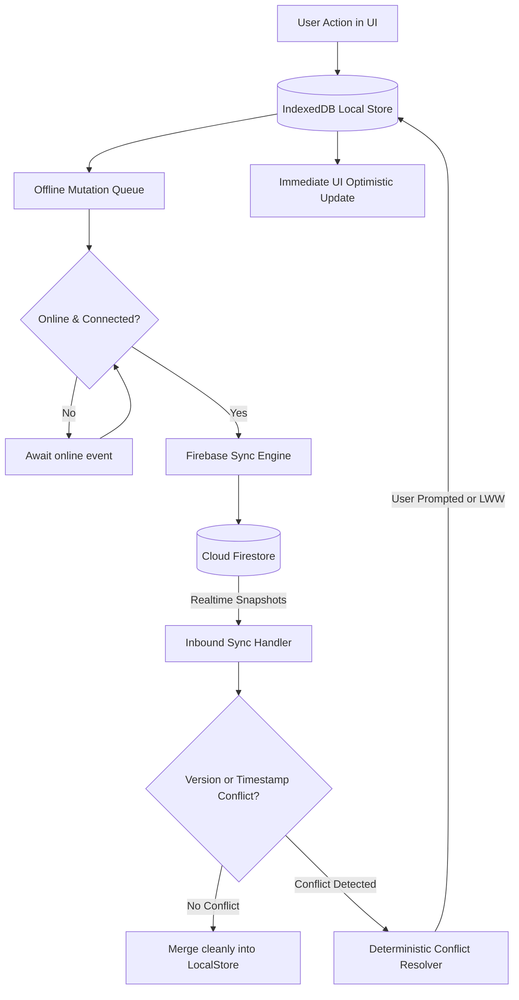
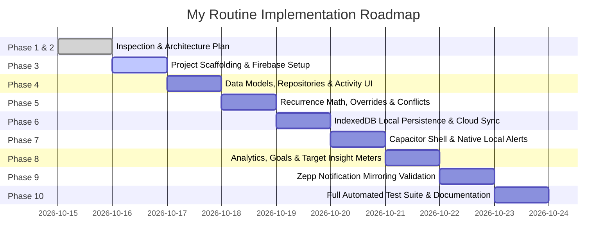

# My Routine — System Architecture & Implementation Plan

## 1. Executive Summary & Repository Status

### Repository Inspection (Phase 1)
- **Directory**: `c:\Users\YogeshMurdeshwar\projects\self\my-routine`
- **Current State**: Initialized Git repository on branch `main` with zero commits and an empty working tree.
- **Environment**: Node.js `v25.8.1`, npm `11.11.0`, Windows 11 host.
- **Target Platforms**: Web (Progressive Web Application) and Android Shell via Capacitor, targeting phone notifications mirrored to Zepp / Amazfit smartwatches.

---

## 2. Technical Stack & Architectural Decisions

| Layer | Technology Choice | Rationale & Compatibility |
| :--- | :--- | :--- |
| **Framework** | Next.js 15+ (App Router) with React 19 / 18 | Industry standard SSR/SSG/SPA hybrid. Enables rapid mobile-optimized web UI and static export capability for Capacitor Android shell. |
| **Language** | TypeScript (Strict Mode) | Zero `any` tolerance; comprehensive compile-time validation of recurrence rules, event occurrences, and Firestore payloads. |
| **Styling & UI** | Tailwind CSS + Radix UI Primitives + Lucide Icons | High-performance, bespoke styling with accessible headless primitives (dialogs, popovers, dropdowns, switches). Avoids bloat and guarantees responsive mobile-first aesthetics. |
| **Validation** | Zod (v3) | Strict boundary schema validation for templates, overrides, execution logs, goals, and sync messages. |
| **Backend & Sync** | Firebase Auth + Cloud Firestore + Firebase Security Rules | Per-user isolation, offline indexed reads/writes, real-time snapshot listeners, fine-grained document security rules. |
| **Native Shell** | Capacitor (v6+) + `@capacitor/local-notifications` | Native Android APK generation; handles exact local alarms, boot reconciliation, and standard Android notification channels mirrored by the Zepp app. |
| **Local Persistence** | IndexedDB (Dexie.js or idb-keyval) + Firestore Local Cache | Dual-layer persistence: fully functional offline editing queue even when disconnected, deterministic sync reconciliation. |
| **Testing** | Vitest + React Testing Library + Playwright + Firebase Rules Emulator | High-speed unit tests for recurrence math & conflict detection; component integration tests; end-to-end user journeys; security rules verification. |

---

## 3. Data Architecture & Firestore Schema

### Firestore Security Model
- Path pattern: `/users/{userId}/*`
- All reads and writes enforce `request.auth != null && request.auth.uid == userId`.
- Schema invariants validated in security rules (timestamps, string limits, required IDs).

---

## 4. Recurrence, Override, and Splitting Model

When editing an activity, the user can choose one of three update scopes:
1. **This occurrence only**:
   - Creates or updates an `OccurrenceOverride` document for `(templateId, date)`.
   - The original `RoutineTemplate` is untouched.
   - Calendar queries calculate effective occurrences by layering overrides onto generated recurring instances.
2. **This and all future occurrences**:
   - The current `RoutineTemplate` has its `recurrence.endDate` set to the day before (`date - 1`).
   - A new `RoutineTemplate` is created with `recurrence.startDate = date` containing the updated fields.
   - Historical records and prior logs remain completely intact and linked to their original template version.
3. **All occurrences (base template)**:
   - Updates the existing `RoutineTemplate` in place.
   - Preserves existing historical overrides and logs unless specifically requested.

---

## 5. Conflict Detection & Classification Engine

A conflict engine evaluates the active schedule for any given date:
- **Error Condition (Critical)**:
  - Overlap with a `isFixed: true` activity (e.g., School drop-off, Melodyarc IST meeting, MA Onsite call). Fixed events are legally protected and cannot be silently double-booked.
  - Invalid temporal bounds: `startTime >= endTime` (unless explicitly spanning midnight with proper duration flag).
- **Warning Condition (Advisory)**:
  - Overlap between two flexible activities (suggesting priority or time-shift).
  - Activity scheduled during designated Quiet/Sleep window (e.g., past 11:30 PM bedtime).
  - Daily Target Discrepancy: Goal target requires 120 minutes (e.g., Fullmoon Styles), but scheduled routine blocks total only 30 minutes, producing an Unscheduled Goal Deficit.
  - Total scheduled waking activities exceeding 24 hours or leaving zero transition buffers.

---

## 6. Offline Persistence, Sync & Reconciliation Architecture

- **Zero Data Loss Guarantee**: Uncommitted local edits are recorded in an IndexedDB mutation log with auto-increment sequence IDs.
- **Reconciliation**: On reconnect, pending mutations replay sequentially. If a remote document was updated more recently by another client, the app presents a Diff Dialog (Local vs Cloud) allowing the user to pick or merge, never silently overwriting.

---

## 7. Native Notification Architecture & Zepp/Amazfit Mirroring

### Pipeline
1. **Local Schedule Window**: App maintains alarms for the rolling 72-hour window.
2. **Capacitor Plugin**: `@capacitor/local-notifications` schedules exact alarms with native Android alarm manager.
3. **Reconciliation Triggers**:
   - Routine edited or template saved.
   - App launched or foregrounded.
   - Device reboot (`android.intent.action.BOOT_COMPLETED` handled by Capacitor).
   - Sync completed from remote.
4. **Notification Content & Actions**:
   - Channel: High priority channel (`importance: 4`), vibration pattern enabled.
   - Action buttons: `[Done]`, `[Snooze 10m]`, `[Skip]`.
   - Body format: `6:10 AM - 6:40 AM (30 min) • Routine alert`.
5. **Zepp / Amazfit Mirroring**:
   - Zepp app intercepts Android notification bar events for selected apps.
   - Prerequisite documentation provided in-app:
     1. Phone Settings -> Apps -> My Routine -> Battery -> "Unrestricted".
     2. Phone Settings -> Special App Access -> Alarms & Reminders -> Allowed.
     3. Zepp App -> Profile -> Watch -> App Alerts -> Enable "My Routine".
     4. Zepp App -> Background running permission granted.

---

## 8. Seeded Initial Routine & Target Verification

The initial seeded state accurately matches the user's explicit daily structure:

| Time Window | Activity | Category | Fixed? | Daily Goal Association |
| :--- | :--- | :--- | :--- | :--- |
| **06:00 AM** | Wake Up | Health & Sleep | Yes | Wake-up target (6:00 AM) |
| **06:10 – 06:40 AM** | Meditation | Mindfulness | No | Meditation (30m) |
| **06:40 – 06:50 AM** | Journalling | Personal | No | Journalling (10m) |
| **06:50 – 07:20 AM** | Mindvalley / Self-learning | Learning | No | Mindvalley / Self-learning (30m) |
| **07:30 – 08:30 AM** | Keshav's School Routine | Family | Yes | — |
| **08:30 – 09:00 AM** | Breakfast and Commute | Personal & Transit | No | — |
| **09:00 AM – 01:00 PM**| Main-Job Work (Morning Block) | Career / Work | Yes | Melodyarc / ArayNatech |
| **01:00 – 01:30 PM** | Fullmoon Styles / Megh Malhaar | Business | No | Fullmoon / Megh Malhaar (part 1) |
| **01:30 – 02:00 PM** | Transition | Buffer | No | — |
| **02:00 – 02:30 PM** | Lunch | Health & Food | No | — |
| **02:30 – 03:30 PM** | Power Nap | Rest | No | Power Nap (60m) |
| **03:30 – 04:00 PM** | Transition | Buffer | No | — |
| **04:00 – 04:30 PM** | Melodyarc IST Meeting | Career / Work | Yes | Melodyarc / ArayNatech |
| **04:30 – 06:45 PM** | Keshav's Football & Cycling | Family & Fitness | Yes | Cycling & Exercise (2h 15m) |
| **06:45 – 07:15 PM** | Shower and Dinner | Personal & Food | No | — |
| **07:15 – 08:00 PM** | Main-Job Work (Evening Block 1) | Career / Work | Yes | Melodyarc / ArayNatech |
| **08:00 – 08:30 PM** | MA Onsite Call | Career / Work | Yes | Melodyarc / ArayNatech |
| **08:30 – 09:45 PM** | Main-Job Work (Evening Block 2) | Career / Work | Yes | Melodyarc / ArayNatech |
| **09:45 – 10:00 PM** | Daily Review | Personal | No | Review & Planning |
| **10:00 – 11:30 PM** | Protected Family Time | Family | Yes | Protected family block |
| **11:30 PM – Midnight** | Bedtime Window | Sleep | Yes | Sleep window |

**Goal Deficit Analysis Engine**:
- Fullmoon Styles & Megh Malhaar goal is 2h (120m), but scheduled block is 30m -> Flagged as **Unscheduled Goal Warning: 90m deficit**.
- Coursera target is 30m daily, but not scheduled in default routine -> Flagged as **Unscheduled Goal Warning: 30m unscheduled**.

---

## 9. Step-by-Step 10-Phase Execution Plan

- **Phase 1: Inspection & Structure**: Examine workspace, verify tooling (Complete).
- **Phase 2: Architecture & Plan**: Detailed design document, schema, and sign-off (Current).
- **Phase 3: Scaffolding & Firebase Integration**:
  - Initialize Next.js with TypeScript, Tailwind CSS, shadcn/ui components.
  - Setup Firebase client configuration, Auth provider, Firestore SDK, and Security Rules file.
  - Setup Vitest and Playwright test rigs.
- **Phase 4: Routine Data Models & UI Editor**:
  - Implement Zod schemas and TypeScript domain types.
  - Build Activity List, Today Timeline, and Rich Activity Editor modal (title, times, categories, fixed toggle, reminders).
  - Seed initial routine and seed target configurations.
- **Phase 5: Recurrence, Overrides & Conflict Detection**:
  - Recurrence engine (daily, weekly, weekdays, weekends, custom days).
  - Occurrence override engine (single day vs future vs base template).
  - Conflict detection engine (errors for fixed event overlaps, warnings for flexible overlaps & unscheduled goals).
  - Day, Week, and Month calendar views.
- **Phase 6: Local Persistence & Firebase Synchronization**:
  - IndexedDB storage layer with offline mutation queue.
  - Firestore snapshot synchronization and two-way reconciliation.
  - Conflict resolution UI.
- **Phase 7: Native Local Notifications (Capacitor)**:
  - Add Capacitor Android configuration.
  - Implement `@capacitor/local-notifications` manager with rolling 72-hour scheduler, quiet hours, and snooze actions.
  - Reboot & app foreground reconciliation.
- **Phase 8: Analytics, Goals & Insights**:
  - Real-time planned vs. actual execution tracking (one-tap start/complete/skip).
  - Daily & weekly target progress meters and category distribution charts.
- **Phase 9: Zepp / Amazfit Mirroring**:
  - Android notification channel optimization for Zepp mirroring.
  - In-app device setup assistant and diagnostic checklist.
- **Phase 10: Automated Tests, Security Audit & Deployment**:
  - Unit tests for recurrence & conflict calculation.
  - Security rules unit tests via Firebase Emulator.
  - End-to-end user workflows.
  - Comprehensive documentation: README, `.env.example`, architecture log, and APK build guide.
