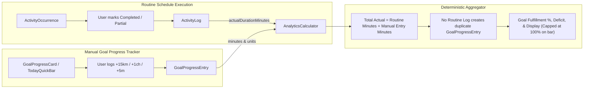

# Investigation: Improve Goal Progress Tracking with Minute-Level & Unit-Based Updates

## 1. Relevant Repository Structure

```
my-routine/
├── src/
│   ├── app/
│   │   └── page.tsx                     # Top-level state coordination (goals, logs, occurrences, goalProgress)
│   ├── components/
│   │   ├── analytics/
│   │   │   ├── analytics-tab.tsx        # Daily & Weekly Analytics; renders Daily Goal Targets
│   │   │   ├── goal-progress-card.tsx   # Interactive GoalProgressCard with unit buttons & history
│   │   │   └── goal-editor-dialog.tsx   # Modal for configuring GoalTarget min/max/target minutes
│   │   ├── goals/
│   │   │   ├── goals-dashboard.tsx      # LifeGoals dashboard
│   │   │   └── log-progress-modal.tsx
│   │   └── routine/
│   │       ├── today-timeline.tsx       # Daily activity timeline with collapsible Daily Goals bar
│   │       ├── today-goal-quick-bar.tsx # Compact collapsible Daily Goals tracker
│   │       └── activity-timeline-item.tsx
│   ├── lib/
│   │   ├── analytics/
│   │   │   ├── analytics-calculator.ts  # Core calculation engine for planned/actual/deficit
│   │   │   └── analytics-calculator.test.ts # Vitest suite for analytics
│   │   ├── goals/
│   │   │   ├── goal-progress-calculator.ts # Unified calculation & unit conversion engine
│   │   │   └── goal-progress.test.ts   # Vitest unit tests for calculations and repository
│   │   ├── repositories/
│   │   │   ├── goal-repository.ts       # Local storage & Firestore sync for GoalTarget
│   │   │   ├── goal-progress-repository.ts # Local storage & Firestore sync for GoalProgressEntry
│   │   │   └── log-repository.ts        # Local storage & Firestore sync for ActivityLog
│   │   ├── seed-data.ts                 # getInitialGoalTargets(userId) with 9 daily goals
│   │   ├── sync/
│   │   │   ├── backup-service.ts        # Full JSON database export/import
│   │   │   ├── mutation-queue.ts        # Offline mutation queue with SyncCollection
│   │   │   └── sync-engine.ts           # Background Firestore sync engine
│   │   └── time-utils.ts                # Date formatting, formatDuration, Asia/Kolkata
│   └── types/
│       ├── routine.ts                   # GoalTarget, ActivityLog, RoutineTemplate schemas
│       ├── goal-progress.ts             # GoalProgressEntry schema & calculation interfaces
│       └── goals.ts                     # LifeGoal schemas
```

---

## 2. Existing Implementation & Behavior

### A. Daily Goal Targets Representation
In `src/types/routine.ts` (lines 150–165), `GoalTarget` is defined as:
```ts
export const GoalTargetSchema = z.object({
  id: z.string(),
  userId: z.string(),
  title: z.string().min(1),
  categories: z.array(z.string()).default([]),
  templateIds: z.array(z.string()).default([]),
  frequency: z.enum(['daily', 'weekly']).default('daily'),
  targetMinutes: z.number().min(1),
  minMinutes: z.number().optional(),
  maxMinutes: z.number().optional(),
  targetTime: z.string().regex(/^([01]\d|2[0-3]):[0-5]\d$/).optional(),
  activeDays: z.array(z.number().min(0).max(6)).default([0, 1, 2, 3, 4, 5, 6]),
  isArchived: z.boolean().default(false),
  updatedAt: z.number(),
});
export type GoalTarget = z.infer<typeof GoalTargetSchema>;
```

In `src/lib/seed-data.ts` (lines 526–651), `getInitialGoalTargets(userId: string)` seeds the 9 daily goals:
1. `goal_melodyarc_araynatech` (Melodyarc & ArayNatech) — `targetMinutes: 510` (8.5 hours), `activeDays: [1, 2, 3, 4, 5]`
2. `goal_fullmoon_meghmalhaar` (Fullmoon Styles & Megh Malhaar) — `targetMinutes: 120` (2 hours)
3. `goal_cycling_exercise` (Cycling & Exercise) — `targetMinutes: 120` (2 hours, native tracking: km)
4. `goal_meditation` (Meditation) — `targetMinutes: 30` (native tracking: minutes)
5. `goal_coursera` (Coursera) — `targetMinutes: 30`, `templateIds: []` (native tracking: topics/modules)
6. `goal_mindvalley` (Mindvalley / Self-learning) — `targetMinutes: 30` (native tracking: chapters/minutes)
7. `goal_journalling` (Journalling) — `targetMinutes: 10` (native tracking: minutes)
8. `goal_power_nap` (Power Nap) — `targetMinutes: 60` (native tracking: minutes)
9. `goal_wakeup_target` (Wake-up Target) — `targetMinutes: 10`, `targetTime: '06:00'` (native tracking: minutes)

---

## 3. Analysis of Goal-Specific Tracking Units

Per user directive:
> *"it should be minimum level that can be tracked for goal*
> *for cycling, user should be able to add number to goal i.e. if user cycled for 15 km just allow user to add 15*
> *for book reading, chapter level tracking make sense as that is the minimum level*
> *for courses, if user added course, module, topic then goal can be tracked at topic level"*

### Tracking Dimensions & Conversions
1. **Cycling & Exercise (`goal_cycling_exercise`)**:
   - Primary unit: `km` (kilometers).
   - Minimum level: `1 km`. Quick actions: `+1 km`, `+5 km`, `+10 km`, `+15 km`.
   - Numeric input: User can type `15` to record 15 km.
   - Conversion to duration: Outdoor city cycling pace is reliably 3.0 min/km (20 km/h). 15 km = 45 minutes; 20 km = 60 minutes; 40 km = 120 minutes (achieving the 120m daily goal).
   - Both the kilometer distance (e.g. `15 km`) and duration (`45m`) are captured and displayed.
2. **Book Reading & Self-Learning (`goal_mindvalley`)**:
   - Primary units: `chapters` / `minutes`.
   - Minimum level: `1 chapter` or `5 minutes`. Quick actions: `+1 ch`, `+5 ch`, `+10m`, `+15m`, `+30m`.
   - Conversion: 1 chapter is normalized to ~20 minutes (or custom duration).
3. **Courses (`goal_coursera`)**:
   - Primary units: `topics` / `modules` / `minutes`.
   - Minimum level: `1 topic` (or `1 module`). Quick actions: `+1 topic`, `+1 module`, `+15m`, `+30m`.
   - Conversion: 1 topic = ~15 minutes; 1 module = ~30 minutes (achieving the 30m daily target).
4. **Time-Based Habits (Meditation, Journalling, Work, Power Nap)**:
   - Primary unit: `minutes`.
   - Minimum level: `1 minute`. Quick actions: `+1m`, `+5m`, `+10m`, `+15m`, `+30m`, or custom minutes.

---

## 4. TodayTimeline Integration Analysis

In `src/components/routine/today-timeline.tsx`:
- Lines 220–250 render the timeline header with date switcher, day off status, and summary count.
- Lines 255–650 render current/active activity block and collapsed completed activities.
- Adding a collapsible **Daily Goals Quick Bar** (`TodayGoalQuickBar`) right below the timeline header provides:
  - Collapsed state: A sleek pill row showing total daily goal progress (e.g., `🎯 6 of 9 daily goals active • 210m logged`) with an expand/collapse toggle.
  - Expanded state: A horizontal carousel or compact grid of the 9 daily goal cards with the one-tap quick-add buttons (+1m, +5m, +15km, +1ch, +1 topic) and instant progress feedback.
  - This fulfills the user's confirmation that TodayTimeline should feature an inline collapsible bar.

---

## 5. Double-Counting Prevention Architecture



1. Routine completion writes exclusively to `ActivityLog`.
2. Manual incremental progress writes exclusively to `GoalProgressEntry`.
3. The aggregator sums `routineActualMinutes + manualProgressMinutes` for that goal on that calendar date.
4. There is no automated generation of duplicate `GoalProgressEntry` from routine logs, mathematically eliminating any risk of double-counting.

---

## 6. Recommended Approach

1. Define `GoalProgressEntry` in `src/types/goal-progress.ts` supporting `minutes`, `unit`, `unitValue`, and `note`.
2. Implement `GoalProgressCalculator` with unit conversion helpers and progress calculations.
3. Implement `GoalProgressRepository` with offline `localStorage` and Firestore sync.
4. Update `AnalyticsCalculator` with optional `progressEntries?: GoalProgressEntry[]`.
5. Create `GoalProgressCard` with unit-specific presets.
6. Create `TodayGoalQuickBar` and embed in `TodayTimeline`.
7. Extend `BackupService` with legacy fallback.
8. Add comprehensive Vitest suite in `src/lib/goals/goal-progress.test.ts`.
