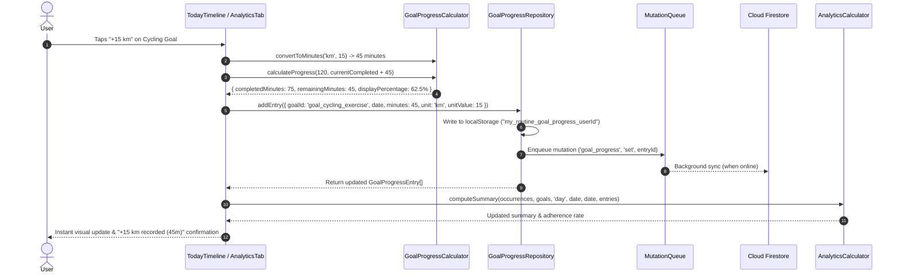

# Implementation Plan: Improve Goal Progress Tracking with Minute-Level & Unit-Based Updates

## A. Proposed Solution

Implement a goal progress tracking system for the 9 daily goal targets in **My Routine** that supports minimum tracking levels across different goal types:
- **Cycling & Exercise**: Track by distance in kilometers (e.g. `15` km, `+1 km`, `+5 km`, `+10 km`, `+15 km`) with automated conversion to routine duration (3 min/km pace).
- **Book Reading**: Track by chapters (`+1 ch`, `+5 ch`) or minutes.
- **Courses**: Track by topics or modules (`+1 topic`, `+1 module`) or minutes.
- **Habits & Work**: Track by minutes (+1m, +5m, +10m, +15m, +30m, or custom minutes).

Progress will be accessible from both:
1. An interactive `GoalProgressCard` suite in `AnalyticsTab` with full entry history and editing.
2. A collapsible **Daily Goals Quick Bar** (`TodayGoalQuickBar`) directly in `TodayTimeline` so users can log progress without navigating away.

Calculations use accumulated integer minutes against normalized daily targets, preserving true accumulated minutes when exceeding 100%, rounding display percentages to one decimal place, and calculating remaining minutes accurately. An offline repository (`GoalProgressRepository`) provides offline caching and Cloud Firestore sync.

---

## B. Architecture & Data Flow



---

## C. Data Model Changes

### 1. `GoalProgressEntry` Schema (`src/types/goal-progress.ts`)
```ts
import { z } from 'zod';

export const GoalTrackingUnitSchema = z.enum([
  'minutes',
  'km',
  'chapters',
  'pages',
  'topics',
  'modules',
]);
export type GoalTrackingUnit = z.infer<typeof GoalTrackingUnitSchema>;

export const GoalProgressSourceSchema = z.enum([
  'manual',
  'routine_completion',
  'timer',
]);
export type GoalProgressSource = z.infer<typeof GoalProgressSourceSchema>;

export const GoalProgressEntrySchema = z.object({
  id: z.string(), // e.g., `gpe_${Date.now()}_${Math.random().toString(36).substring(2, 8)}`
  userId: z.string(),
  goalId: z.string().min(1, 'Goal ID is required'),
  date: z.string().regex(/^\d{4}-\d{2}-\d{2}$/, 'Date must be YYYY-MM-DD'),
  minutes: z.number().int().nonnegative('Minutes must be non-negative integer'),
  unit: GoalTrackingUnitSchema.default('minutes'),
  unitValue: z.number().positive().optional(),
  source: GoalProgressSourceSchema.default('manual'),
  routineLogId: z.string().optional(),
  note: z.string().default(''),
  createdAt: z.number(),
  updatedAt: z.number(),
});
export type GoalProgressEntry = z.infer<typeof GoalProgressEntrySchema>;

export interface CalculatedGoalProgress {
  targetMinutes: number;
  completedMinutes: number;
  remainingMinutes: number;
  rawPercentage: number;
  displayPercentage: number;
  isAchieved: boolean;
  isOverTarget: boolean;
  overTargetMinutes: number;
  primaryUnit?: GoalTrackingUnit;
  totalUnitValue?: number;
}
```

### 2. Backup Package Schema Extension (`src/lib/sync/backup-service.ts`)
```ts
export interface RoutineBackupPackage {
  version: '1.0' | '1.1' | '1.2';
  exportedAt: string;
  userId: string;
  templates: RoutineTemplate[];
  overrides: OccurrenceOverride[];
  logs: ActivityLog[];
  goals: GoalTarget[];
  lifeGoals?: LifeGoal[];
  dayTemplates?: DayRoutineTemplate[];
  weeklyPlanner?: WeeklyPlannerConfig;
  goalProgress?: GoalProgressEntry[]; // New field
}
```

---

## D. File-by-File Implementation Plan

| File or Directory | Action | Purpose | Verification |
|---|---|---|---|
| `src/types/goal-progress.ts` | **Create** | Zod schemas and TypeScript types for `GoalProgressEntry`, `GoalTrackingUnit`, and `CalculatedGoalProgress`. | Unit tests in `goal-progress.test.ts` |
| `src/lib/goals/goal-progress-calculator.ts` | **Create** | Calculation engine for minute-level progress, unit conversion (km, chapters, topics), 1-decimal rounding, and aggregation. | Calculation unit tests |
| `src/lib/repositories/goal-progress-repository.ts` | **Create** | Offline `localStorage` caching, Firestore sync, entry creation, undo, and deletion. | Persistence unit tests |
| `src/lib/sync/mutation-queue.ts` | **Modify** | Add `'goal_progress'` to `SyncCollection`. | TypeScript check & sync tests |
| `src/lib/sync/backup-service.ts` | **Modify** | Include `goalProgress` in backup export and import with legacy fallback. | Backup unit tests |
| `src/lib/analytics/analytics-calculator.ts` | **Modify** | Extend `computeSummary` to accept `progressEntries?: GoalProgressEntry[]` and aggregate manual + routine minutes. | `analytics-calculator.test.ts` |
| `src/components/analytics/goal-progress-card.tsx` | **Create** | Interactive goal progress card with unit-specific quick-add buttons (+15km, +1ch, +1 topic, +5m), custom input, undo, and history popover. | Component tests & manual UI check |
| `src/components/analytics/analytics-tab.tsx` | **Modify** | Render new interactive `GoalProgressCard` components within the Daily Goal Targets section. | Visual check in browser |
| `src/components/routine/today-goal-quick-bar.tsx` | **Create** | Compact collapsible quick-progress widget for the Today routine view. | Visual check in browser |
| `src/components/routine/today-timeline.tsx` | **Modify** | Integrate `TodayGoalQuickBar` allowing users to log daily goals without leaving the timeline. | Visual check in browser |
| `src/app/page.tsx` | **Modify** | Load `goalProgress` state, wire `handleRecordGoalProgress` and `handleUndoGoalProgress`, pass to tabs. | End-to-end integration |
| `src/lib/goals/goal-progress.test.ts` | **Create** | Comprehensive Vitest suite covering all calculation, unit conversion, edge case, and repository scenarios. | `npm test` |
| `package.json`, `version.json`, `android/app/build.gradle`, `public/download/index.html` | **Modify** | Bump version to `1.4.0` (`versionCode: 6`) per incremental change rule. | Build checks |

---

## E. Implementation Phases

### Phase 1: Models & Unit-Aware Calculation Engine
- **Objective**: Create `GoalProgressEntry` schema and `GoalProgressCalculator`.
- **Tasks**:
  1. Author `src/types/goal-progress.ts` with Zod validation.
  2. Implement `GoalProgressCalculator`:
     - Unit conversion helpers: `kmToMinutes(km: 15) -> 45m`, `chaptersToMinutes(ch: 1) -> 20m`, `topicsToMinutes(topics: 1) -> 15m`.
     - `calculateProgress(targetMinutes, completedMinutes)`: integer minutes, 1-decimal rounding, remaining minutes calculation, over-target preservation.
     - `aggregateGoalMinutes(goal, occurrences, entries, date)`: sums routine log duration + manual entries without double counting.
  3. Create initial test file `src/lib/goals/goal-progress.test.ts` covering calculation and conversion cases.
- **Validation**: Vitest passes for calculation and unit tests.

### Phase 2: Offline Repository & Sync Integration
- **Objective**: Create `GoalProgressRepository`, update `MutationQueue`, and upgrade `BackupService`.
- **Tasks**:
  1. Author `GoalProgressRepository` with offline `localStorage` caching, `addEntry`, `deleteEntry`, `undoLastEntry`, and Firestore realtime subscription.
  2. Add `'goal_progress'` to `SyncCollection` in `src/lib/sync/mutation-queue.ts`.
  3. Update `BackupService` in `src/lib/sync/backup-service.ts` to export and restore `goalProgress`, maintaining backward compatibility for legacy v1.0 and v1.1 packages.
- **Validation**: Vitest tests for repository persistence, undo, and backup import/export pass.

### Phase 3: Analytics Engine Integration
- **Objective**: Update `AnalyticsCalculator` to seamlessly aggregate manual goal progress.
- **Tasks**:
  1. Update `AnalyticsCalculator.computeSummary` to accept optional `progressEntries?: GoalProgressEntry[]`.
  2. For each goal target, combine routine occurrence logged minutes with manual progress entries matching the target date/range.
  3. Ensure goals with no routine occurrences (e.g. Coursera) accumulate progress properly and exit `'unscheduled'` when progress is logged.
  4. Update top-level `totalActualMinutes` and adherence calculations.
- **Validation**: `analytics-calculator.test.ts` passes with zero regressions.

### Phase 4: Interactive Goal Progress UI Components
- **Objective**: Build reusable, accessible quick-add and custom entry UI for both `AnalyticsTab` and `TodayTimeline`.
- **Tasks**:
  1. Create `src/components/analytics/goal-progress-card.tsx`:
     - Displays title, target duration, completed minutes/units, remaining minutes, progress bar.
     - Dynamic quick-add pill buttons based on goal:
       - Cycling: `+1 km`, `+5 km`, `+10 km`, `+15 km`.
       - Reading: `+1 ch`, `+5 ch`, `+10m`, `+15m`, `+30m`.
       - Coursera: `+1 topic`, `+1 module`, `+15m`, `+30m`.
       - Other: `+1m`, `+5m`, `+10m`, `+15m`, `+30m`.
     - Custom input toggle allowing manual numeric input (e.g. typing `15` for 15 km) and optional note.
     - Inline undo button and expandable entry history for today.
     - Transient feedback badge (e.g. `+15 km recorded (45m)`).
  2. Update `src/components/analytics/analytics-tab.tsx` to render `GoalProgressCard` for each active daily goal.
  3. Create `src/components/routine/today-goal-quick-bar.tsx` with collapsible summary pill row and expander for one-tap goal logging.
  4. Integrate `TodayGoalQuickBar` into `src/components/routine/today-timeline.tsx`.
- **Validation**: Check interactive states and touch targets in desktop and mobile views.

### Phase 5: App Coordination & State Wiring
- **Objective**: Wire goal progress state into `src/app/page.tsx`.
- **Tasks**:
  1. Add `goalProgress: GoalProgressEntry[]` state to `page.tsx`.
  2. Subscribe to `GoalProgressRepository` on user login / mount.
  3. Provide `handleRecordGoalProgress` and `handleUndoGoalProgress` handlers.
  4. Pass state and handlers into `AnalyticsTab` and `TodayTimeline`.
- **Validation**: Logging progress in `TodayTimeline` instantly reflects in `AnalyticsTab` and vice versa without page reload.

### Phase 6: Automated Testing, Version Bump, & Build Verification
- **Objective**: Full test verification, version increment, and production builds.
- **Tasks**:
  1. Run full Vitest suite (`npm test`).
  2. Run TypeScript compilation (`npx tsc --noEmit`).
  3. Bump version to `1.4.0` (`versionCode: 6`) across `package.json`, `public/version.json`, `android/app/build.gradle`, and `public/download/index.html`.
  4. Verify production builds: `npm run build:web` and `npm run build:mobile`.
  5. Finalize documentation in `docs/tasks/feature-007-minute-level-goal-progress/`.
- **Validation**: All checks exit with code 0.

---

## F. Testing Strategy

1. **Calculation & Unit Conversion Tests (`goal-progress.test.ts`)**:
   - 1-minute progress: 1 min / 30 min -> 3.3%, 29 min remaining.
   - Cycling km input: 15 km -> 45 min, 75 min remaining / 120 min target -> 37.5%.
   - Reading chapter input: 1 ch -> 20 min, 10 min remaining / 30 min target -> 66.7%.
   - Course topic input: 1 topic -> 15 min, 15 min remaining / 30 min target -> 50.0%.
   - Exact target completion: 30 min / 30 min -> 100.0%, 0 min remaining, `isAchieved: true`.
   - Over-target progress: 35 min / 30 min -> 100.0% capped display, 35 min true duration, 0 min remaining, `isAchieved: true`.
   - Fractional hour target normalization: 8.5 hours converted to 510 minutes -> 255 min = 50.0%.
   - Zero or invalid target duration handling.
2. **Double-Counting Prevention Tests**:
   - Scheduled routine occurrence completed (30m) + manual entry (5m) = 35m.
   - Goal with no routine block (Coursera, 30m target) + manual entry (15m) = 50% on track.
3. **Persistence & Undo Tests**:
   - Local storage save and reload.
   - Undo removes the latest entry for that specific goal and date.
   - Deleting a specific entry removes it from the daily total.
   - Date isolation: entries logged for yesterday do not alter today's progress.
4. **Backup Tests**:
   - Full backup export contains `goalProgress`.
   - Legacy v1.0 and v1.1 backups restore safely without error.
5. **System & Build Verification**:
   - `npm test` (all tests passing).
   - `npx tsc --noEmit` (0 errors).
   - `npm run build:web` (clean Turbopack static export).
   - `npm run build:mobile` (Capacitor Android sync clean).

---

## G. Definition of Done

- [ ] `GoalProgressEntry` and `CalculatedGoalProgress` types created with Zod validation.
- [ ] `GoalProgressCalculator` implemented with unit conversions (km, chapters, topics, minutes) and tested across all calculation cases.
- [ ] `GoalProgressRepository` implemented with offline `localStorage` and Firestore sync.
- [ ] `MutationQueue` and `BackupService` updated to include `goal_progress`.
- [ ] `AnalyticsCalculator` updated to accept progress entries and aggregate them without double-counting.
- [ ] Interactive `GoalProgressCard` component created with unit-aware quick-add buttons, custom input, undo, and entry history.
- [ ] `AnalyticsTab` updated to render interactive goal cards.
- [ ] Collapsible `TodayGoalQuickBar` added to `TodayTimeline`.
- [ ] State wired end-to-end in `src/app/page.tsx`.
- [ ] Comprehensive automated tests in `src/lib/goals/goal-progress.test.ts`.
- [ ] Version incremented to `1.4.0` (`versionCode: 6`).
- [ ] `npm test`, `npx tsc --noEmit`, `npm run build:web`, and `npm run build:mobile` all pass cleanly.
- [ ] Task documentation finalized.
