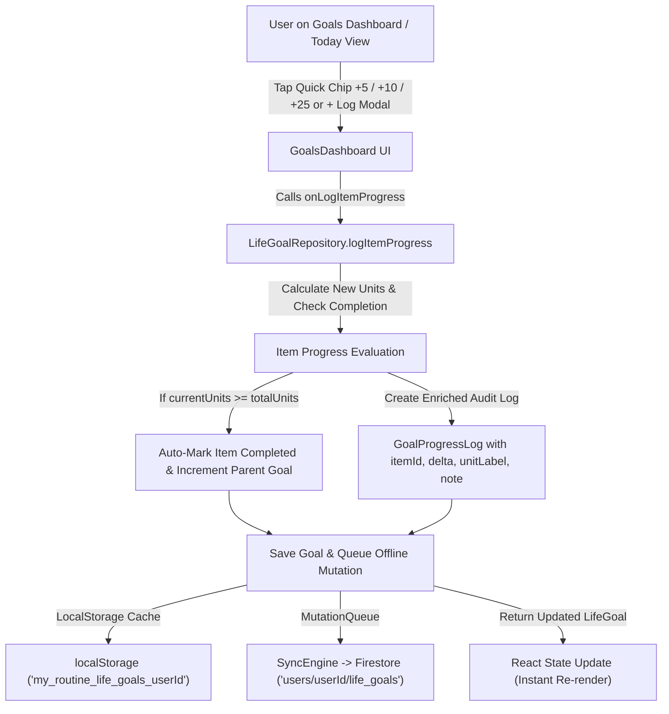

# Implementation Plan: Life Goals Minor & Incremental Progress Tracking

## 1. Technical Architecture & Data Flow



---

## 2. File-by-File Detailed Changes

### File 1: `src/types/goals.ts`
1. **Extend `GoalProgressLogSchema`**:
   ```ts
   export const GoalProgressLogSchema = z.object({
     id: z.string(),
     date: z.string().regex(/^\d{4}-\d{2}-\d{2}$/),
     valueChange: z.number(),
     currentValue: z.number(),
     note: z.string().default(''),
     createdAt: z.number().default(() => Date.now()),

     // Minor / Item-Level Progress Extensions (Optional)
     itemId: z.string().optional(),
     itemTitle: z.string().optional(),
     unitLabel: z.string().optional(),
     phaseId: z.string().optional(),
     phaseTitle: z.string().optional(),
     itemCurrentUnits: z.number().optional(),
     itemTotalUnits: z.number().optional(),
   });
   ```
2. **Extend `GoalTrackedItemSchema`**:
   Add optional `quickIncrements?: z.array(z.number()).optional()` to allow custom increment chips per item (with smart fallbacks).

---

### File 2: `src/lib/repositories/life-goal-repository.ts`
1. **Implement `logItemProgress`**:
   ```ts
   static async logItemProgress(
     userId: string,
     goalId: string,
     itemId: string,
     data: {
       deltaUnits: number;
       note?: string;
       date?: string;
       setAbsoluteUnits?: number;
     }
   ): Promise<{ goal: LifeGoal; updatedItem: GoalTrackedItem; completedNow: boolean } | null>
   ```
   - Looks up the goal and item.
   - Computes new `currentUnits`:
     `newUnits = data.setAbsoluteUnits !== undefined ? data.setAbsoluteUnits : Math.max(0, item.currentUnits + data.deltaUnits)`.
   - Determines completion: `isDone = item.totalUnits > 0 && newUnits >= item.totalUnits`.
   - If `isDone && item.status !== 'completed'`: marks item `completed`, records `completedAt = Date.now()`.
   - If parent goal has `metricType === 'numeric'`, increments parent `currentValue` by 1.
   - Appends a new `GoalProgressLog` entry with `itemId`, `itemTitle`, `unitLabel`, `valueChange: data.deltaUnits`, `currentValue: newCurrentGoalValue`, `itemCurrentUnits: newUnits`, `itemTotalUnits: item.totalUnits`, `note`, `date`.
   - Saves to LocalStorage and queues for Firestore sync.
   - Returns the updated goal and item.

2. **Implement `undoProgressLog`**:
   ```ts
   static async undoProgressLog(
     userId: string,
     goalId: string,
     logId: string
   ): Promise<LifeGoal | null>
   ```
   - Locates the log entry in `goal.progressLogs`.
   - If the log was linked to an `itemId`:
     - Subtracts `log.valueChange` from the item's `currentUnits`.
     - If the item was completed and drops below `totalUnits`, reverts status to `'in_progress'`.
     - Reverts parent goal `currentValue` if it was incremented upon completion.
   - If the log was goal-level:
     - Subtracts `log.valueChange` from `goal.currentValue`.
   - Removes the log entry from `goal.progressLogs`.
   - Saves the updated goal.

3. **Enhance `recalculateGoalProgress`**:
   - Add support for `'items'` tracking mode:
     `currentValue = items.filter(i => i.status === 'completed').length; targetValue = items.length;`
   - Ensure progress percentages remain mathematically bounded between 0% and 100%.

---

### File 3: `src/components/goals/item-quick-progress.tsx` (New Component)
Dedicated, highly polished sub-component for tracked items:
1. **Dynamic Increment Chips**:
   - For `unitLabel === 'pages'`: `+5`, `+10`, `+25`, `+50`.
   - For `unitLabel === 'minutes' | 'mins'`: `+5m`, `+10m`, `+15m`, `+30m`.
   - For `unitLabel === 'modules' | 'chapters' | 'topics'`: `+1`, `+2`, `+5`.
   - Default: `+1`, `+5`, `+10`.
2. **One-Tap Quick Increment**:
   - Tapping any chip immediately adds progress with micro-animation and haptic/toast feedback.
3. **Custom Progress Modal Trigger**:
   - `+ Log` button opening `LogItemProgressModal` to input custom amount, date, and note/reflection.

---

### File 4: `src/components/goals/log-item-progress-modal.tsx` (New Component)
A tailored modal for recording item progress:
- Visual preview: `Current Units -> Projected Units / Total Units` with percentage bar.
- Delta input with `+` / `-` steppers and preset chip shortcuts.
- Date picker (defaults to today in `Asia/Kolkata`).
- Optional note/reflection input (e.g. *"Read chapter 3 - Time Blocking"*).
- Checkbox: *"Mark item as fully completed"*.

---

### File 5: `src/components/goals/goals-dashboard.tsx`
1. **Render `ItemQuickProgress`** in the Items tab under each book, course, or project card.
2. **Wire Handlers**:
   - `onLogItemProgress` and `onUndoProgressLog`.
3. **Enhanced History / Audit View**:
   - Under the History tab, render enriched badges showing what item or sub-entity was progressed.
   - Provide an "Undo" icon button on each log entry allowing one-tap reversal.
4. **Item Completion Celebration**:
   - Highlight completed items with celebratory emerald badges and strike-through text.

---

### File 6: `src/app/page.tsx`
1. Implement `handleLogItemProgress`:
   Calls `LifeGoalRepository.logItemProgress` and updates React `lifeGoals` state.
2. Implement `handleUndoGoalProgressLog`:
   Calls `LifeGoalRepository.undoProgressLog` and updates React `lifeGoals` state.
3. Pass handlers to `<GoalsDashboard />`.

---

## 3. Routine Activity Integration

When a user completes a scheduled routine activity linked to a Life Goal (e.g. *Mindvalley / Self-learning* linked to *Read 30 books*):
- In `LifeGoalRepository.recordActivityForGoal`, if the goal has active in-progress items, allow automatically logging reading progress or prompt the user with a quick prompt: *"Log 25 pages to Deep Work?"*.

---

## 4. Test Plan & Vitest Verification

Add comprehensive tests in `src/lib/repositories/life-goals.test.ts`:
1. `logs minor incremental progress on tracked item (+10 pages) and records enriched progress log`:
   - Verify `item.currentUnits` increases from 185 to 195.
   - Verify `goal.progressLogs` receives an entry with `itemId`, `itemTitle`, `valueChange: 10`, `unitLabel: 'pages'`.
2. `automatically completes item and increments parent goal when totalUnits is reached`:
   - Start item at 300/304 pages, log `+10 pages`.
   - Verify `item.currentUnits` is 304, `item.status === 'completed'`.
   - Verify parent goal `currentValue` increases from 8 to 9.
3. `reverses progress and restores item units with undoProgressLog`:
   - Log `+15 pages`, then call `undoProgressLog`.
   - Verify item units roll back and the log is removed.
4. `handles custom units (minutes, modules, chapters) deterministically`:
   - Verify audiobook minutes and course modules accumulate correctly.
5. `full regression suite`:
   - Run `npx vitest run src/lib/repositories/life-goals.test.ts`.
   - Run `npm run build:web` to ensure production compilation.
