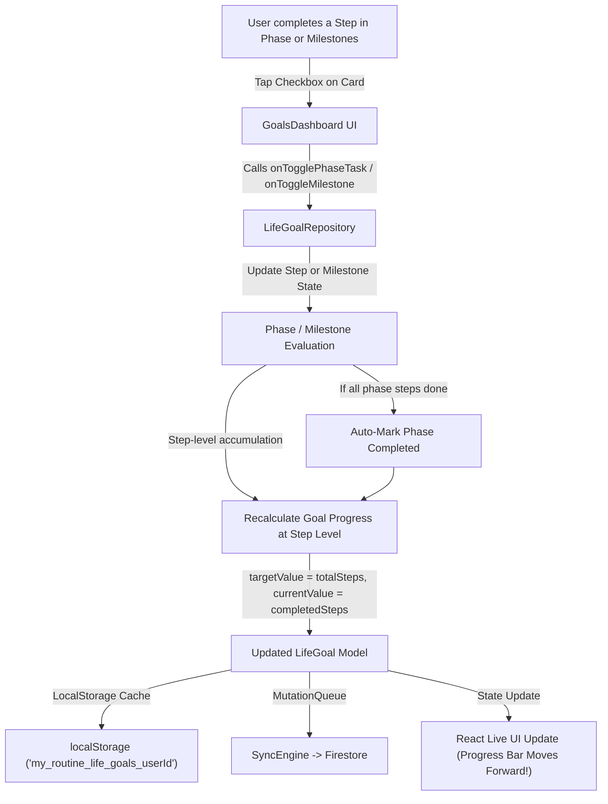

# Implementation Plan: Life Goals Small Milestones & Phase Step-Level Progress Tracking

## 1. Technical Architecture & Data Flow



---

## 2. File-by-File Detailed Changes

### File 1: `src/types/goals.ts`
1. **Extend `GoalTrackingModeSchema`**:
   Add `'milestones'` mode:
   ```ts
   export const GoalTrackingModeSchema = z.enum([
     'milestones', // Step-by-step small milestones
     'phases',    // Multi-stage roadmap progression
     'tasks',     // Tasks & checklist completion %
     'metric',    // Traditional numeric target
     'items',     // Detailed tracked items
     'habits',    // Routine activity streaks
     'journey',   // Qualitative journey
   ]);
   ```
2. **Extend `GoalMilestoneSchema`**:
   Add optional `description?: string` and `targetDate?: string`:
   ```ts
   export const GoalMilestoneSchema = z.object({
     id: z.string(),
     title: z.string().min(1, 'Milestone title is required'),
     description: z.string().optional().default(''),
     targetDate: z.string().optional(),
     isCompleted: z.boolean().default(false),
     completedAt: z.number().optional(),
   });
   ```
3. **Extend `GoalProgressLogSchema`**:
   Add optional `milestoneId?: string; milestoneTitle?: string; stepId?: string; stepTitle?: string;`.

---

### File 2: `src/lib/repositories/life-goal-repository.ts`
1. **Update `recalculateGoalProgress`**:
   - For `trackingMode === 'phases'`: calculate `targetValue` as total steps across all phases (phases without tasks count as 1 unit), and `currentValue` as completed steps.
   - For `trackingMode === 'milestones'` or `goal.metricType === 'milestone'`: calculate `targetValue = milestones.length` and `currentValue = milestones.filter(m => m.isCompleted).length`.
2. **Update `togglePhaseTask`**:
   - Updates task completion.
   - Automatically synchronizes parent phase status (`completed` if all tasks done; `in_progress` if some done).
   - Records progress log entry.
   - Recalculates goal progress at the step level.
3. **Update `togglePhaseStatus`**:
   - When marking a phase completed, if it has tasks, marks all tasks in that phase as completed.
   - Recalculates goal progress.
4. **Implement Milestone Operations**:
   - `addMilestone(userId, goalId, data: { title: string; description?: string; targetDate?: string })`: creates new `GoalMilestone`, appends to `goal.milestones`, recalculates progress, and saves.
   - `deleteMilestone(userId, goalId, milestoneId)`: filters out milestone, recalculates progress, and saves.
   - `updateMilestone(userId, goalId, milestoneId, updates)`: updates fields, recalculates, and saves.
   - Enhance `toggleMilestone`: toggles completion, logs audit entry, recalculates progress, and saves.

---

### File 3: `src/components/goals/goal-editor-modal.tsx`
1. **Add `milestones` Tracking Mode in UI**:
   - In "Select How to Track Progress" grid (lines 974-1034), add:
     - ID: `'milestones'`
     - Icon: `<Milestone className="w-5 h-5 text-amber-400" />`
     - Title: `'Key Milestones & Steps'`
     - Description: `'Progress moves forward as small milestones are completed step-by-step.'`
2. **Add Milestones Tab**:
   - Add tab button in the modal header: `Milestones (${milestones.length})` with icon `<Milestone className="w-3.5 h-3.5" />`.
   - Milestones panel:
     - Form to add new milestone with Title, Target Date, and Description.
     - List of milestones with completion checkbox, target date badge, and delete button.
     - Quick preset suggestions if empty.
3. **Update Step-Level Calculation in `handleSubmit`**:
   - When `trackingMode === 'phases'`, computes `parsedTarget` from total phase steps and `parsedCurrent` from completed phase steps.
   - When `trackingMode === 'milestones'`, computes `parsedTarget = milestones.length` and `parsedCurrent = completedMilestones`.
   - Passes managed `milestones` state to saved `LifeGoal`.

---

### File 4: `src/components/goals/goals-dashboard.tsx`
1. **Add Milestones Tab on Goal Cards**:
   - In `activeCardTabs`, add `'milestones'` option.
   - Tab header: `Milestones (${completedMilestonesCount}/${milestones.length})` with icon `<Milestone className="w-3.5 h-3.5" />`.
   - Visible if `goal.trackingMode === 'milestones'`, `milestones.length > 0`, or always available.
2. **Milestones Tab Content**:
   - Summary bar: `{completedCount}/{milestones.length} Milestones Achieved ({percentage}%)` with progress bar.
   - List of milestone items:
     - Checkbox: toggles milestone via `onToggleMilestone`.
     - Title with strike-through styling when completed.
     - Target date badge (e.g. `Due Nov 15`).
     - Delete action button.
   - Inline "Add small milestone..." form at the bottom (input + date + Add button, Enter key support) for frictionless logging.
3. **Enhance Roadmap & Phases Tab**:
   - Header shows `{completedStepsCount}/{totalStepsCount} Steps Completed` in addition to phase count.
   - Each phase card displays a mini step badge: `{phaseDoneSteps}/{phaseTotalSteps} steps` with a mini progress bar.
   - Checking steps immediately moves the goal's main progress bar forward.

---

### File 5: `src/app/page.tsx`
1. Implement handlers:
   - `handleAddGoalMilestone = async (goalId, data) => { ... }`
   - `handleDeleteGoalMilestone = async (goalId, milestoneId) => { ... }`
2. Pass `onAddMilestone` and `onDeleteMilestone` to `<GoalsDashboard />`.

---

### File 6: `src/lib/repositories/life-goals.test.ts`
1. Test step-level phase progress calculation:
   - Verifies that toggling a step inside a phase moves the goal's `currentValue` from 0 to 1 out of total steps.
   - Verifies that completing all steps in a phase auto-completes the phase.
   - Verifies that phases without sub-tasks still contribute 1 unit safely.
2. Test milestone tracking mode and operations:
   - Verifies `addMilestone`, `toggleMilestone`, and `deleteMilestone`.
   - Verifies that `trackingMode === 'milestones'` dynamically updates `targetValue` and `currentValue`.

---

### File 7: Versioning
- `package.json`: Bump to `1.6.0`.
- `public/version.json`: Bump to `1.6.0` (`versionCode: 9`), add changelog entries.

---

## 3. Verification & Quality Assurance Plan

1. **Automated Unit Testing**:
   - Run `npx vitest run src/lib/repositories/life-goals.test.ts`.
2. **Type Safety & Build Verification**:
   - Run `npm run build:web` to ensure zero compilation or lint errors.
3. **Manual Flow Verification**:
   - Create a goal with Roadmap & Phases and 3 steps in Phase 1 -> check 1 step -> verify progress bar advances.
   - Check all 3 steps -> verify Phase 1 auto-completes.
   - Create a goal with Key Milestones mode -> add 3 small milestones -> toggle 1 -> verify 33% progress.
