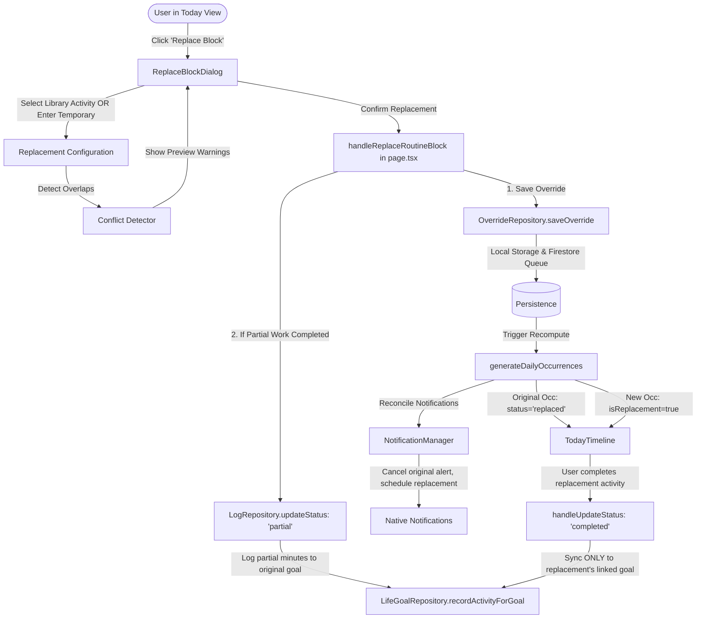

# Feature-015: Investigation Findings — Flexible Routine Block Replacement

## 1. Repository Structure Relevant to the Task

The investigation examined the scheduling engine, persistence layer, notification manager, analytics calculator, life goal tracking system, and routine UI components:

```
src/
├── types/
│   ├── routine.ts                 # RoutineTemplate, OccurrenceOverride, ActivityLog, ActivityOccurrence, ActivityStatus
│   ├── goals.ts                   # LifeGoal, GoalActivityRecord, GoalProgressLog
│   ├── goal-progress.ts           # GoalProgressEntry, GoalTrackingUnit, GoalProgressSource
│   └── routine-templates.ts       # DayRoutineTemplate, WeeklyPlannerConfig
├── lib/
│   ├── occurrence-generator.ts    # generateDailyOccurrences: synthesizes daily blocks from templates, overrides, and logs
│   ├── conflict-detector.ts       # detectScheduleConflicts: pairwise time overlap, sleep window, and goal deficit checks
│   ├── time-utils.ts              # timeToMinutes, calculateDuration, isTimeOverlapping, formatTime12Hour, formatDuration
│   ├── notifications/
│   │   └── notification-manager.ts # compute72HourSchedule, reconcileNotifications, cancelAllNotifications
│   ├── analytics/
│   │   └── analytics-calculator.ts # computeSummary: category breakdowns, actual duration calculation, statusCounts
│   └── repositories/
│       ├── override-repository.ts # getLocalOverrides, saveOverride, deleteOverride, Firestore sync
│       ├── log-repository.ts      # getLocalLogs, updateStatus, toggleStep, addComment, saveLog
│       ├── routine-repository.ts  # getLocalTemplates, saveTemplate, duplicateTemplate, archiveRoutine
│       ├── life-goal-repository.ts # syncCompletedRoutineToLifeGoals, recordActivityForGoal
│       └── goal-progress-repository.ts # addEntry, getEntriesForGoal, getEntriesForDate
├── components/
│   ├── routine/
│   │   ├── today-timeline.tsx     # TodayTimeline: renders occurrences, date switcher, status updates
│   │   ├── activity-timeline-item.tsx # ActivityTimelineItem: 1-tap checkbox, title, action strip (play, skip, edit, delete)
│   │   ├── current-activity-card.tsx # CurrentActivityCard: active activity card, countdown, media, steps, comments
│   │   ├── activity-editor-dialog.tsx # ActivityEditorDialog: routine editor modal
│   │   └── recurrence-edit-scope-dialog.tsx # RecurrenceEditScopeDialog: this_occurrence, future, all
│   └── app/
│       └── page.tsx               # Main container: state orchestration, handleUpdateStatus, handleSaveActivity
```

---

## 2. Existing Implementation and Behavior

### A. Occurrence Override Model & Generation
- In [`src/types/routine.ts:97-113`](file:///c:/Users/YogeshMurdeshwar/projects/self/my-routine/src/types/routine.ts#L97-L113):
  ```ts
  export const OccurrenceOverrideSchema = z.object({
    id: z.string(),
    userId: z.string(),
    templateId: z.string(),
    date: z.string().regex(/^\d{4}-\d{2}-\d{2}$/),
    modifiedStartTime: z.string().regex(/^([01]\d|2[0-3]):[0-5]\d$/).optional(),
    modifiedEndTime: z.string().regex(/^([01]\d|2[0-3]):[0-5]\d$/).optional(),
    modifiedTitle: z.string().optional(),
    isCancelled: z.boolean().default(false),
    isPostponed: z.boolean().default(false),
    postponedToDate: z.string().regex(/^\d{4}-\d{2}-\d{2}$/).optional(),
    notes: z.string().optional(),
    modifiedMedia: z.array(MediaAttachmentSchema).optional(),
    modifiedSteps: z.array(TaskStepSchema).optional(),
    updatedAt: z.number(),
  });
  ```
- In [`src/lib/occurrence-generator.ts:43-120`](file:///c:/Users/YogeshMurdeshwar/projects/self/my-routine/src/lib/occurrence-generator.ts#L43-L120):
  When generating daily occurrences:
  ```ts
  const startTime = override?.modifiedStartTime ?? template.startTime;
  const endTime = override?.modifiedEndTime ?? template.endTime;
  const title = override?.modifiedTitle ?? template.title;
  ```
  If an override modifies the title, the original title is discarded from the occurrence. There is no concept of a "replacement activity" separate from the "planned activity".

### B. Activity Lifecycle Statuses
- In [`src/types/routine.ts:115-123`](file:///c:/Users/YogeshMurdeshwar/projects/self/my-routine/src/types/routine.ts#L115-L123):
  ```ts
  export const ActivityStatusSchema = z.enum([
    'pending',
    'in_progress',
    'completed',
    'partial',
    'skipped',
    'postponed',
  ]);
  ```
  Statuses `'replaced'` and `'rescheduled'` do not exist.

### C. Life Goal Completion Sync
- In [`src/app/page.tsx:1130-1156`](file:///c:/Users/YogeshMurdeshwar/projects/self/my-routine/src/app/page.tsx#L1130-L1156):
  ```ts
  if (status === 'completed') {
    const duration = occurrence.durationMinutes || calculateDuration(occurrence.startTime, occurrence.endTime);
    LifeGoalRepository.syncCompletedRoutineToLifeGoals(
      userId,
      selectedDate,
      occurrence.templateId,
      occurrence.title,
      duration,
      occurrence.log?.completionNotes || ''
    );
  }
  ```
- In [`src/lib/repositories/life-goal-repository.ts:1489-1514`](file:///c:/Users/YogeshMurdeshwar/projects/self/my-routine/src/lib/repositories/life-goal-repository.ts#L1489-L1514):
  `syncCompletedRoutineToLifeGoals` searches for life goals matching `templateId`:
  `const matchingGoals = all.filter((g) => g.linkedTemplateIds?.includes(templateId));`
  If a replaced occurrence completes with the original `templateId`, the original goal is credited with the replacement activity's duration!
  For example, if Reading is replaced with Project Work, completing the block adds 60 minutes to the user's "Read 30 books" goal.

### D. Action Bar in Timeline & Current Card
- In [`src/components/routine/activity-timeline-item.tsx:355-465`](file:///c:/Users/YogeshMurdeshwar/projects/self/my-routine/src/components/routine/activity-timeline-item.tsx#L355-L465):
  Action buttons include: Play (Start), Skip, Unskip, Reset to pending, Comments, Edit (opens `ActivityEditorDialog`), Duplicate, and Delete.
  There is no dedicated action to replace a block or adapt the routine.
- In [`src/components/routine/current-activity-card.tsx:33-70`](file:///c:/Users/YogeshMurdeshwar/projects/self/my-routine/src/components/routine/current-activity-card.tsx#L33-L70):
  The current activity card displays the current running block with quick actions, but lacks a "Replace" button.

### E. Notification Reconciler
- In [`src/lib/notifications/notification-manager.ts:181-260`](file:///c:/Users/YogeshMurdeshwar/projects/self/my-routine/src/lib/notifications/notification-manager.ts#L181-L260):
  `compute72HourSchedule` generates occurrences via `generateDailyOccurrences` and schedules notifications for any occurrence where `!occ.isCancelled` and `status !== 'completed' && status !== 'skipped'`.
  If an occurrence is replaced, it must be excluded from original reminder notifications, and the replacement occurrence must receive properly timed notifications.

### F. Analytics Calculator
- In [`src/lib/analytics/analytics-calculator.ts:56-62`](file:///c:/Users/YogeshMurdeshwar/projects/self/my-routine/src/lib/analytics/analytics-calculator.ts#L56-L62):
  `statusCounts` only tallies `completed`, `partial`, `in_progress`, `skipped`, and `pending`.
  Any unrecognized status defaults to `pending`.
  Furthermore, `totalActualMinutes` assumes full planned duration if `completed`, which would double-count if both original and replacement were counted.

---

## 3. Relevant Files, Components, Functions, and Models

| File / Component | Symbol / Function | Responsibility |
|---|---|---|
| [`src/types/routine.ts`](file:///c:/Users/YogeshMurdeshwar/projects/self/my-routine/src/types/routine.ts) | `ActivityStatusSchema`, `OccurrenceOverrideSchema`, `ActivityOccurrence` | Core data models for statuses, single-day overrides, and computed daily occurrences |
| [`src/lib/occurrence-generator.ts`](file:///c:/Users/YogeshMurdeshwar/projects/self/my-routine/src/lib/occurrence-generator.ts) | `generateDailyOccurrences` | Resolves templates, overrides, and logs into sorted chronological daily occurrences |
| [`src/lib/conflict-detector.ts`](file:///c:/Users/YogeshMurdeshwar/projects/self/my-routine/src/lib/conflict-detector.ts) | `detectScheduleConflicts`, `isTimeOverlapping` | Detects collisions between fixed commitments and flexible routine blocks |
| [`src/lib/repositories/override-repository.ts`](file:///c:/Users/YogeshMurdeshwar/projects/self/my-routine/src/lib/repositories/override-repository.ts) | `OverrideRepository` | Local storage persistence and Firestore synchronization for occurrence overrides |
| [`src/lib/repositories/life-goal-repository.ts`](file:///c:/Users/YogeshMurdeshwar/projects/self/my-routine/src/lib/repositories/life-goal-repository.ts) | `syncCompletedRoutineToLifeGoals`, `recordActivityForGoal` | Attributes completed routine work to matching Life Goals |
| [`src/lib/notifications/notification-manager.ts`](file:///c:/Users/YogeshMurdeshwar/projects/self/my-routine/src/lib/notifications/notification-manager.ts) | `compute72HourSchedule`, `reconcileNotifications` | Schedules and cancels notifications within rolling 72-hour window |
| [`src/lib/analytics/analytics-calculator.ts`](file:///c:/Users/YogeshMurdeshwar/projects/self/my-routine/src/lib/analytics/analytics-calculator.ts) | `AnalyticsCalculator.computeSummary` | Computes adherence rates, status breakdowns, and planned vs actual minutes |
| [`src/components/routine/activity-timeline-item.tsx`](file:///c:/Users/YogeshMurdeshwar/projects/self/my-routine/src/components/routine/activity-timeline-item.tsx) | `ActivityTimelineItem` | Renders individual timeline card, status badges, and action buttons |
| [`src/components/routine/current-activity-card.tsx`](file:///c:/Users/YogeshMurdeshwar/projects/self/my-routine/src/components/routine/current-activity-card.tsx) | `CurrentActivityCard` | Prominently displays currently active routine block with countdown and actions |
| [`src/app/page.tsx`](file:///c:/Users/YogeshMurdeshwar/projects/self/my-routine/src/app/page.tsx) | `MyRoutineApp`, `handleUpdateStatus` | Top-level state coordination and dialog wiring |

---

## 4. Reusable Utilities and Services

1. **`timeToMinutes`, `minutesToTime`, `calculateDuration`, `isTimeOverlapping`** in [`src/lib/time-utils.ts`](file:///c:/Users/YogeshMurdeshwar/projects/self/my-routine/src/lib/time-utils.ts):
   Provides rock-solid time math, duration calculation, and overlap detection without external dependencies.
2. **`detectScheduleConflicts`** in [`src/lib/conflict-detector.ts`](file:///c:/Users/YogeshMurdeshwar/projects/self/my-routine/src/lib/conflict-detector.ts):
   Can be directly reused inside the replacement dialog to validate candidate replacement time slots before the user commits them.
3. **`OverrideRepository`** in [`src/lib/repositories/override-repository.ts`](file:///c:/Users/YogeshMurdeshwar/projects/self/my-routine/src/lib/repositories/override-repository.ts):
   Handles local caching and offline-safe Firestore synchronization via `MutationQueue` and `cleanForFirestore`.
4. **`CategoryBadge` & `CATEGORY_CONFIG`** in [`src/components/routine/activity-badge.tsx`](file:///c:/Users/YogeshMurdeshwar/projects/self/my-routine/src/components/routine/activity-badge.tsx):
   Renders consistent icons, labels, and badges across categories.

---

## 5. Data Flow and Integration Points



---

## 6. Existing Tests and Missing Coverage

### Existing Tests Passing
- `src/lib/occurrence-generator.test.ts`: 5 tests verifying overrides, cancellation, and recurrence.
- `src/lib/repositories/routine-archival-regression.test.ts`: 12 tests verifying overrides, cancellations, and logs.
- `src/lib/repositories/life-goals.test.ts`: 27 tests verifying life goal updates, activity records, and seed purges.
- `src/lib/notifications/notification-manager.test.ts`: 4 tests for rolling 72-hour window and quiet hours.
- `src/lib/conflict-detector.test.ts`: 3 tests for overlap detection.
- `src/lib/analytics/analytics-calculator.test.ts`: 4 tests for summary calculation.

### Missing Coverage Needed for Feature-015
1. **Occurrence Generator Replacement Tests**:
   - Generating replaced original block with status `'replaced'`.
   - Generating replacement occurrence with `isReplacement: true`.
   - Handling partial work duration for the original activity.
   - Generating rescheduled occurrences when `rescheduledTo` is specified.
2. **Life Goal Sync Isolation Tests**:
   - Verifying completing a replacement block does not increment the original template's life goal.
   - Verifying completing a replacement block increments its own associated goal.
   - Verifying partial progress on replaced block is credited accurately to original goal.
3. **Notification Re-alignment Tests**:
   - Verifying replaced occurrence notifications are cancelled.
   - Verifying replacement occurrence notifications are scheduled.
4. **UI Modal Component Tests**:
   - Testing `ReplaceBlockDialog` rendering, library selection, temporary activity entry, partial minutes, and conflict detection preview.

---

## 7. Compatibility Constraints

1. **Firestore Serialization**:
   All new fields added to `OccurrenceOverrideSchema` and `ActivityOccurrence` must be plain, JSON-serializable primitives (strings, numbers, booleans, nested plain objects). No `undefined` values should be passed to Firestore (`cleanForFirestore` cleans undefineds).
2. **Offline-First Storage**:
   Overrides and logs must continue to write synchronously to `localStorage` before queueing Firestore writes.
3. **Backward Compatibility**:
   Existing saved overrides that do not have `isReplaced` must continue to parse cleanly through Zod with `.optional()` / `.default(false)`.

---

## 8. Potential Regressions and Mitigations

| Risk / Potential Regression | Mitigation |
|---|---|
| **Goal double-counting or wrong goal attribution** | Explicitly check `occurrence.isReplacement` and `occurrence.linkedGoalId` in `syncCompletedRoutineToLifeGoals`. Never fallback to `occurrence.templateId` if `isReplacement` is true. |
| **Notification duplicates** | Ensure `reconcileNotifications` filters out `occ.log?.status === 'replaced'` so the original block never fires alerts once replaced. |
| **Schedule overlap collisions** | Run `isTimeOverlapping` in the dialog before saving and present a clear conflict prompt. |
| **Unwanted template mutation** | Overrides must be scoped strictly to the current date (`selectedDate`) unless the user explicitly chooses recurring scope. |

---

## 9. Recommended Approach

1. **Extend `src/types/routine.ts`**:
   - Add `'replaced'` and `'rescheduled'` to `ActivityStatusSchema`.
   - Add `isReplaced`, `replacementActivity`, `originalActivitySnapshot`, `partialDurationMinutes`, and `rescheduledTo` to `OccurrenceOverrideSchema`.
   - Add `isReplacement`, `replacesTitle`, `replacesTemplateId`, `isReplaced`, `replacement`, `rescheduledFrom` to `ActivityOccurrence`.
2. **Update `src/lib/occurrence-generator.ts`**:
   - Detect `override.isReplaced`.
   - Emit original block with status `replaced` (and partial duration if recorded).
   - Emit replacement block with `isReplacement: true`.
   - Emit rescheduled block if `override.rescheduledTo` is present.
3. **Create `src/components/routine/replace-block-dialog.tsx`**:
   - Dedicated modal with step-by-step or tabbed options:
     - Routine Library selector or Temporary Activity creator.
     - Time slot selector with duration display and overlap warning.
     - Partial work recorder (minutes already spent on original).
     - Reschedule vs Skip choice for original block.
     - Reason input (with fast pills: "Urgent Meeting", "Emergency", "Priority Shift", "Health").
     - Goal link selector.
4. **Update `activity-timeline-item.tsx` and `current-activity-card.tsx`**:
   - Add `onOpenReplaceDialog` handler and `ArrowLeftRight` button.
   - Add visual badge for `Replaced` (slate/violet badge) and `Replacement` (emerald/cyan badge).
5. **Update `LifeGoalRepository.syncCompletedRoutineToLifeGoals`**:
   - Skip replaced original blocks.
   - Route replacement completions only to `occurrence.linkedGoalId`.
6. **Update `NotificationManager` & `AnalyticsCalculator`**:
   - Omit replaced blocks from notifications, schedule replacement notifications.
   - Include `replaced` in analytics status breakdown and calculate actual duration correctly.
